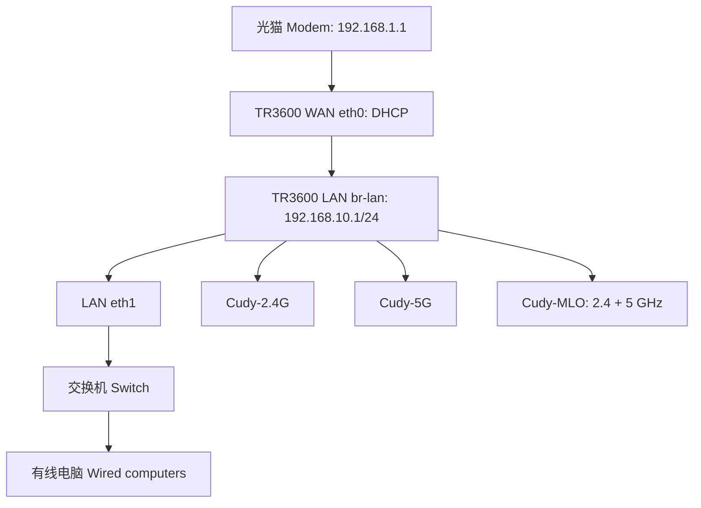
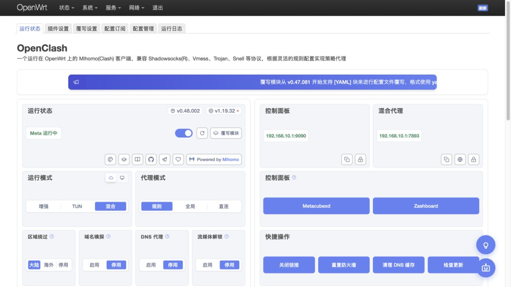

# Cudy TR3600：不刷机安装 OpenClash / OpenClash without reflashing

**中文与 English 对照教程。实机操作：2026-10-18；文档整理：2026-10-19。**

This bilingual guide documents a real installation performed on **18 October 2026**, published on **19 October 2026**.

本次在原有 OpenWrt 固件上安装官方 OpenClash，补齐匹配当前内核的 TUN 模块，配置两份订阅、AdBlock Fast、2.4 GHz / 5 GHz / MLO 三个 Wi-Fi，并修复交换机接入时发现的 LAN/WAN 地址冲突。**没有刷写固件，没有替换正在运行的 Linux 内核。**

The existing firmware was retained. The work added a matching TUN module and official OpenClash, integrated two subscriptions, configured AdBlock Fast and three wireless networks, and corrected a LAN/WAN subnet overlap discovered during wired-network troubleshooting. **No firmware or running-kernel replacement was performed.**

## 阅读顺序 / Reading order

1. [完整操作教程 / Complete installation tutorial](docs/TUTORIAL.md)：恢复后台、网络规划、备份、安装、订阅、启用与回退。
2. [三个 Wi-Fi 与 MLO / Three Wi-Fi networks and MLO](docs/WIFI-MLO.md)：逐项设置、配置示例、验证与限制。
3. [内核适配原理与编译 / Kernel adaptation and build](docs/KERNEL-BUILD.md)：源码、配置校验、编译、符号检查和 APK 打包。
4. [交换机与其他故障排查 / Switch and general troubleshooting](docs/TROUBLESHOOTING.md)。
5. [文件与校验值 / Files and checksums](docs/FILES.md)。
6. [实机验证记录 / Device validation](docs/VALIDATION.md)。
7. [上游来源与许可 / Upstream sources and licensing](THIRD_PARTY_NOTICES.md)。

## 精确适用范围 / Exact compatibility

| 项目 / Item | 本次设备 / Tested device |
|---|---|
| 硬件 / Board | Cudy TR3600 v1 — `cudy,tr3600-v1` |
| 平台 / Target | `mediatek/filogic` |
| 软件包架构 / Package architecture | `aarch64_cortex-a53` |
| 固件 / Firmware | OpenWrt `25.12-SNAPSHOT-CUDY`, `r33005-c484731c5a` |
| Linux | `6.12.93` |
| kernel 包 / Exact kernel package | `6.12.93~f67f61bf2367ca6002566e9da365b1b8-r1` |
| OpenClash | Official `0.48.002` |
| Mihomo | Official ARM64 `1.19.32` |
| 已验证模式 / Verified mode | Fake-IP mixed: TCP redirect + UDP TUN, gVisor, rule mode |

**型号相同、`uname -r` 相同，都不足以证明内核模块兼容。必须核对完整 kernel 包版本、配置和符号条件。** 若不匹配，停止安装这里的自编模块，阅读编译章节重新适配。

**The model name and `uname -r` alone do not establish module compatibility.** Check the complete kernel package version, configuration and symbol conditions. A mismatch means these custom modules must not be installed unchanged.

“完整 OpenClash”指官方 LuCI 插件、Mihomo 核心、订阅、规则分流、透明代理和开机启动均可用。它不表示当前原内核支持插件里的每一种模式。此设备**未安装 `kmod-nft-tproxy`，未启用 IPv6 代理或进程识别**；其余边界见教程。

“Full OpenClash” here means the official LuCI application, Mihomo core, subscriptions, rule routing, transparent proxying and boot startup. It does **not** mean every possible mode is supported by this unchanged vendor kernel. `kmod-nft-tproxy`, IPv6 proxying and process recognition are outside the verified scope.

## 下载所需文件 / Get the required files

从 [v1.0.0 发布页 / release](https://github.com/obsidianplusplus/Cudy-TR3600-OpenClash-Guide/releases/tag/v1.0.0) 获取两个自定义 APK 和对应源码资料。官方 OpenClash 与 Mihomo 从各自官方发布页下载，版本及 SHA256 已固定在 [assets-manifest.json](assets-manifest.json)。

Get the two custom APKs and accompanying source materials from the release. Official OpenClash and Mihomo binaries are downloaded directly from their upstream releases. Versions and SHA256 values are pinned in the manifest.

在**电脑**执行以下命令，只下载和校验文件，不安装到路由器：

Run on your **computer**; this downloads and verifies files without changing the router:

```sh
python3 scripts/fetch_assets.py
```

不要把下载脚本与路由器上的安装步骤混为一谈。先阅读教程并完成备份。

Read the tutorial and complete the private backup before proceeding with router-side installation.

## 最终网络 / Final network



LAN 只保留 `192.168.10.1/24`。不要把光猫的 `192.168.1.1/24` 同时加到 OpenWrt LAN。

Keep only `192.168.10.1/24` on LAN in this topology. Adding the modem's `192.168.1.1/24` to the OpenWrt LAN creates an address and subnet overlap.

## 本仓库的隐私边界 / Private configuration

所有管理员口令、Wi-Fi 口令、真实订阅 URL、节点凭据和完整路由器备份均未发布。示例使用占位符；生成的真实配置默认存入已忽略的 `private/`。

Administrator and Wi-Fi passwords, subscription tokens, node credentials and full router backups are excluded. Examples use placeholders; generated configurations go into the ignored `private/` directory.


